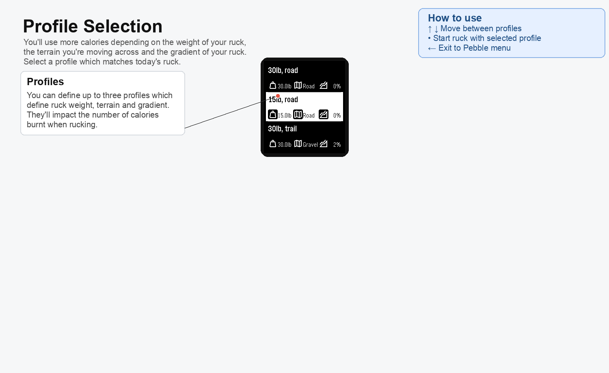
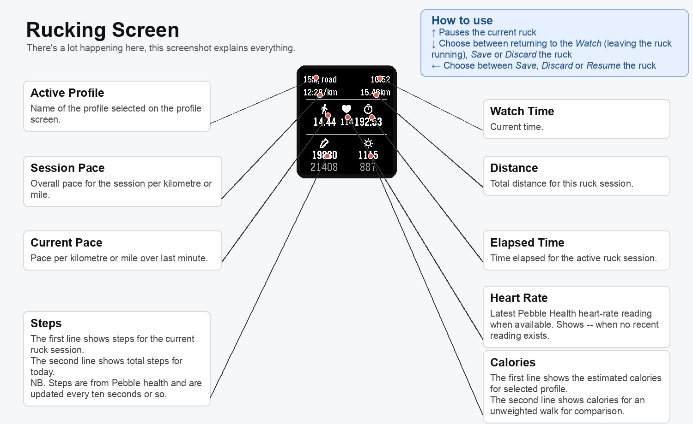
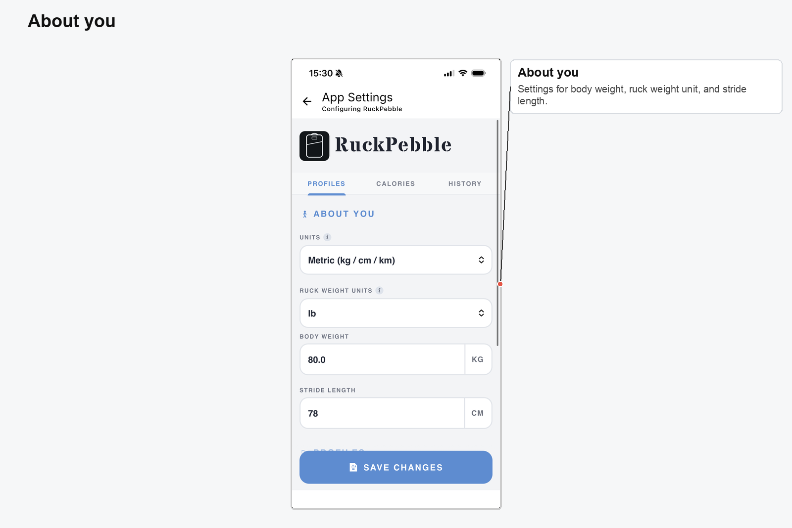
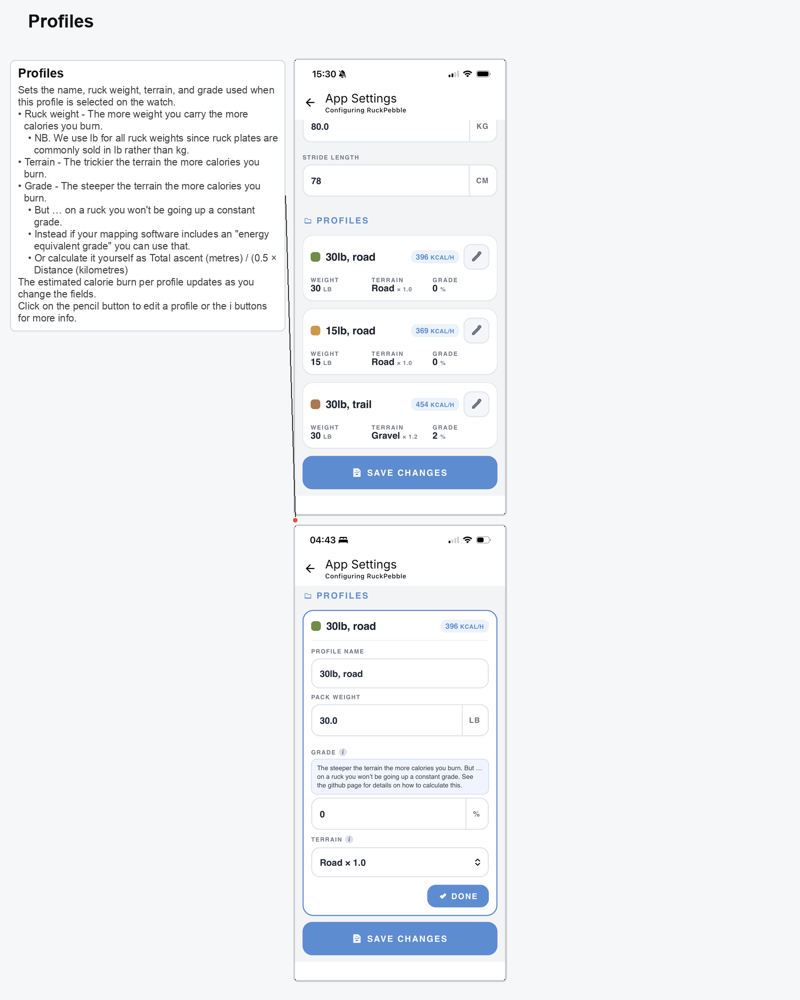
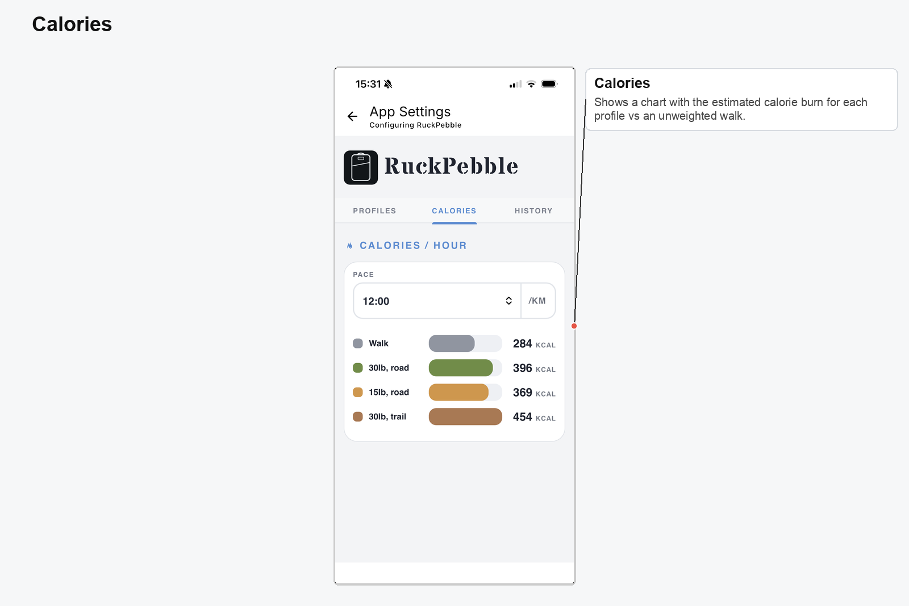
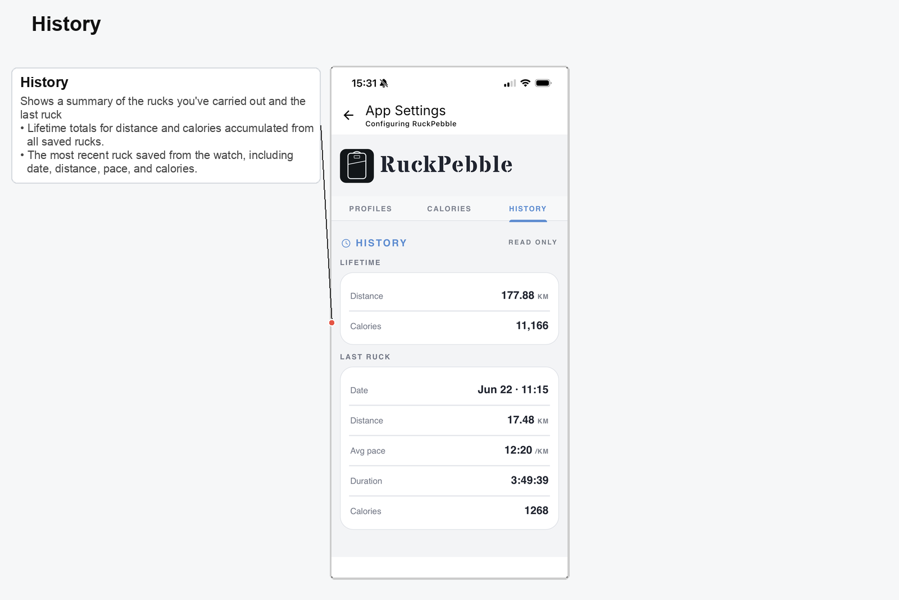

Pebble app which calculates calories expended during a ruck (aka moving quickly with a heavy pack on your back) using a modified version of the Pandolf equation which calculates based on weight, terrain and gradient.

The images below explain how to set up and use the app - please raise an issue if you have questions or suggestions for improvement. 

## Pebble app

---

## Phone settings

--- 

### Logging a ruck to Apple Health
The Pebble app syncs steps, heart rate and sleep to Apple Health, but a third-party watchapp can't create a workout there. Instead, on the History tab tap **Log to Apple Health** (or **Copy ruck data**) to hand your last ruck to an iOS Shortcut:

1. Shortcuts app, new shortcut named exactly **Log Ruck**.
2. **Get Clipboard** (or use *Shortcut Input* when launched by the button) then **Get Dictionary from Input**.
3. **Get Dictionary Value** for `start`, `duration_s`, `distance_m`, `kcal`.
4. **Get Date from** `start`.
5. **Log Workout**: type Hiking or Walking, Duration = `duration_s` seconds, Distance = `distance_m` metres, Active Energy = `kcal`, Start Date = the date from step 4.

Pebble may also log its own auto-detected walk for the same time, so you may see a duplicate.

## Support

Ruckpebble is free and always will be. If it's earned a spot on your watch, you can say thanks with a coffee. No pressure, entirely optional, and hugely appreciated.

Doctor's orders: one coffee a day. So it had better be a good one :-)

## Thanks
* Pandolf equation published by Goruck [here](https://www.goruck.com/en-gb/pages/rucking-calorie-calculator)
* Display layout heavily inspired by the Garmin Walker data field by wwarby
